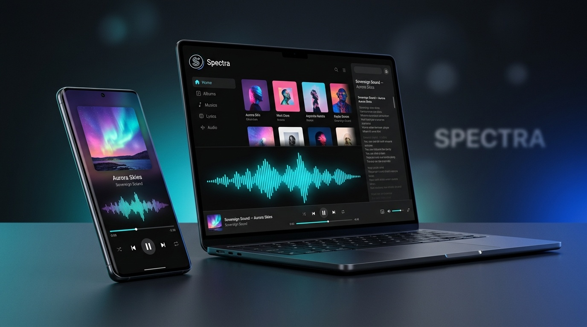
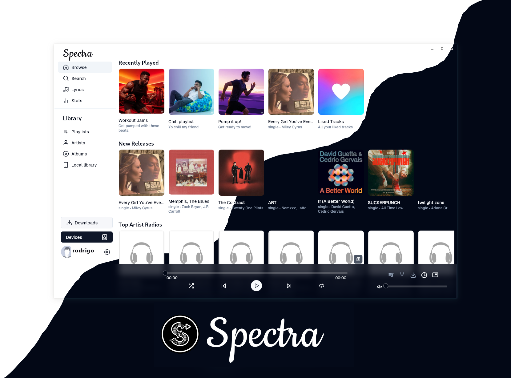
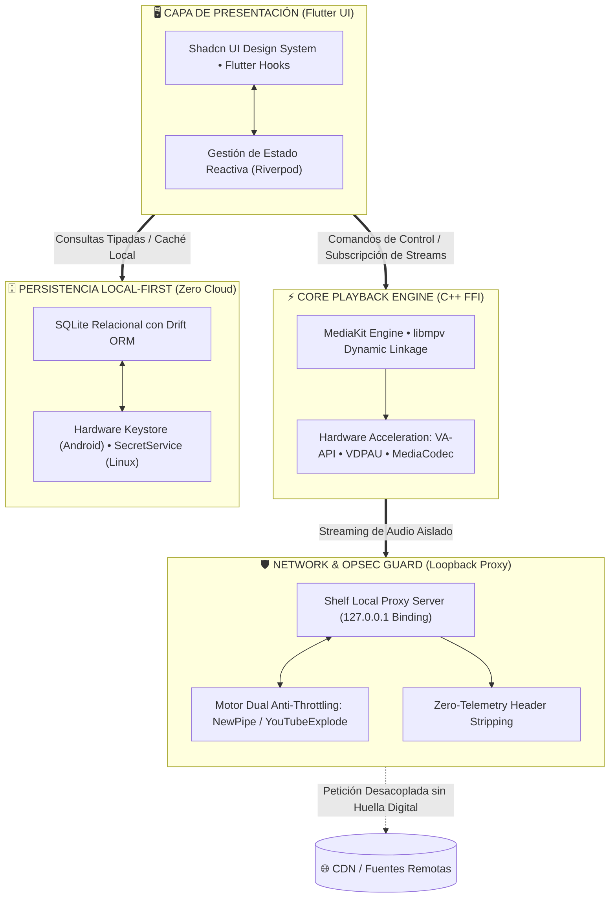
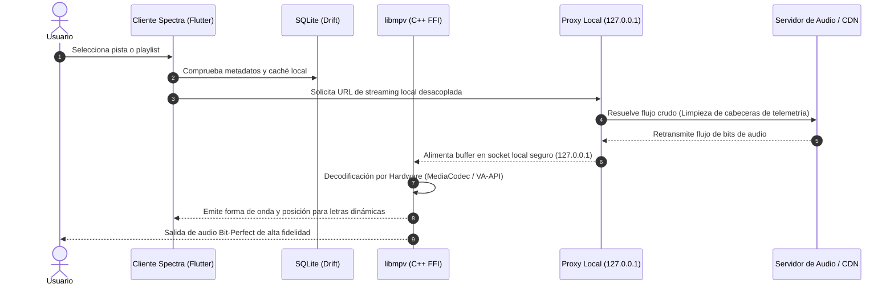

# 🛡️ Spectra — High-Performance Sovereign Music Player

<div align="center">


### *Reproductor y agregador multimedia de alta fidelidad, diseñado bajo el principio de **Privacy by Design**, decodificación nativa acelerada por hardware y **soberanía total sobre tus datos**.*

<br/>

[](https://github.com/rodrigo47363/spectra/releases)
[](LICENSE)
[](#-descargas-y-binarios)
[](PRIVACY_POLICY.md)
[](https://mpv.io)
[](https://flutter.dev)

<br/>

[](https://github.com/rodrigo47363/spectra/stargazers)
[](https://github.com/rodrigo47363/spectra/network)
[](https://github.com/rodrigo47363/spectra/issues)
[](https://github.com/rodrigo47363/spectra/commits)

<br/>

> ### ⚡ **< 0.8s** arranque en frío · **~65 MB** de RAM · **0%** telemetría · **Bit-Perfect** nativo

<br/>

[📱 Vista Previa](#-interfaz-en-acción) • [⚖️ Comparativa](#️-manifiesto-y-comparativa-técnica) • [📦 Descargas](#-descargas-y-binarios) • [🚀 Despliegue](#-despliegue-rápido-instalación-en-1-minuto) • [🌟 Características](#-características-de-grado-operativo) • [🏗️ Arquitectura](#️-arquitectura-del-sistema) • [⚙️ Optimización](#️-optimización-y-ajustes-de-rendimiento) • [🛠️ Compilación](#️-compilación-desde-fuente) • [🔄 DevOps](#-automatización-de-versiones-devops) • [❓ FAQ](#-preguntas-frecuentes-faq) • [🤝 Contribuir](#-contribuir) • [👨‍💻 Autor](#-arquitecto-y-desarrollo)

<br/>


</div>

---

## 📱 Interfaz en Acción

<div align="center">



<br/><br/>

### 🖥️ Ecosistema Móvil · Android


<br/><br/>

### 💻 Experiencia de Escritorio · Linux / Windows


<sub>✨ *Interfaz moderna inspirada en **Shadcn UI**: extracción cromática adaptativa en tiempo real derivada de la carátula del álbum.*</sub>

</div>

---

## 📌 Visión del Proyecto

**Spectra** es una estación de reproducción de medios multiplataforma que resuelve la **degradación actual de los reproductores comerciales**: suscripciones obligatorias, publicidad invasiva, perfiles de comportamiento (*fingerprinting*) y aplicaciones infladas construidas sobre navegadores embebidos que consumen gigabytes de memoria RAM.

Construido combinando la **agilidad visual de Flutter** con la **potencia de decodificación nativa de C++ (`libmpv`)**, Spectra opera bajo el paradigma **BYOMM (*Bring Your Own Music Metadata*)**: desacopla completamente el motor de reproducción de las fuentes de datos, permitiendo explorar, organizar y reproducir música en **alta fidelidad sin ceder tu identidad** a intermediarios comerciales.

<div align="center">

| 🎯 Filosofía | 🛡️ Garantía | ⚡ Rendimiento |
| :---: | :---: | :---: |
| *Tu música, tus reglas* | *Cero rastreo, cero cuentas* | *Bit-perfect nativo* |

</div>

---

## ⚖️ Manifiesto y Comparativa Técnica

> [!IMPORTANT]
> **🛡️ Privacidad Radical:** Spectra **no posee servidores de telemetría**, no vende analíticas a anunciantes y no requiere cuentas obligatorias. Tus listas de reproducción, historial y llaves residen **únicamente en tu dispositivo**.

| Métrica / Capacidad | Clientes Comerciales (Spotify, etc.) | Clientes Basados en Electron | 🛡️ Spectra Player |
| :--- | :---: | :---: | :---: |
| **Publicidad e Interrupciones** | ❌ Frecuente (comerciales de audio) | ⚠️ Depende de la fuente | ✅ **0% Publicidad. Siempre.** |
| **Consumo de Memoria RAM** | ⚠️ ~350 MB – 800 MB | ❌ ~600 MB – 1.4 GB | ⚡ **~65 MB – 120 MB (Nativo C++)** |
| **Tiempo de Inicio en Frío** | ⚠️ ~3.5 s – 6.0 s | ❌ ~4.0 s – 8.0 s | ⚡ **< 0.8 s (AOT Compilado)** |
| **Telemetría & Huella Digital** | ❌ Rastrean clics, pausas y hardware | ⚠️ Telemetría de Chromium embebido | 🔒 **Cero telemetría verificada** |
| **Descarga Offline Libre** | ❌ Archivos cifrados con DRM | ❌ No soportado / Incompleto | ✅ **Audio libre con ID3 tags incrustados** |
| **Motor de Audio** | ⚠️ Decodificadores web cerrados | ⚠️ WebAudio API / HTML5 Audio | 🚀 **`libmpv` Nativo (Bit-Perfect)** |
| **Aceleración por Hardware** | ⚠️ Parcial | ⚠️ Inestable / Alto consumo térmico | ✅ **VA-API / VDPAU / MediaCodec** |
| **Código Auditable** | ❌ Propietario / Ofuscado | ⚠️ Parcialmente abierto | ✅ **100% Código abierto BSD-4** |
| **Distribución** | ⚠️ Atada a tiendas | ⚠️ Atada a tiendas | ✅ **GitHub Releases directo** |

---

## 📦 Descargas y Binarios

**Binarios oficiales firmados**, listos para producción y libres de intermediarios:

| Plataforma | Arquitectura | Formato de Paquete | Enlace de Descarga Directa |
| :--- | :---: | :---: | :--- |
| **Linux (Debian/Ubuntu/Mint/Parrot)** | `x86_64 / amd64` | Paquete `.deb` | [📥 **Descargar Spectra-v1.1.1.deb**](https://github.com/rodrigo47363/spectra/releases/download/v1.1.1/Spectra-v1.1.1-linux-x86_64.deb) |
| **Linux (Universal)** | `x86_64 / amd64` | Tarball Portable (`.tar.xz`) | [📥 **Descargar Bundle (.tar.xz)**](https://github.com/rodrigo47363/spectra/releases/download/v1.1.1/spectra-linux-1.1.1-x86_64.tar.xz) |
| **Linux (Universal)** | `x86_64 / amd64` | Tarball Estándar (`.tar.gz`) | [📥 **Descargar Bundle (.tar.gz)**](https://github.com/rodrigo47363/spectra/releases/download/v1.1.1/Spectra-v1.1.1-linux-x86_64.tar.gz) |
| **Android** | `arm64-v8a` | APK Release (Moderno) | [📥 **Descargar APK arm64-v8a**](https://github.com/rodrigo47363/spectra/releases/download/v1.1.1/Spectra-android-arm64-v8a.apk) |
| **Android** | `armeabi-v7a` | APK Release (Legacy) | [📥 **Descargar APK armeabi-v7a**](https://github.com/rodrigo47363/spectra/releases/download/v1.1.1/Spectra-android-armeabi-v7a.apk) |
| **Windows 10 / 11** | `x86_64` | Portable Bundle (`.zip`) | [📥 **Descargar Spectra-windows-x64.zip**](https://github.com/rodrigo47363/spectra/releases/download/v1.1.1/Spectra-windows-x64.zip) |

### 🧭 ¿Cuál debo descargar según mi dispositivo?

| Si tu dispositivo es... | Descarga este archivo | Razón / Detalle |
| :--- | :--- | :--- |
| 📱 **Teléfono Android moderno**<br/>*(Samsung, Xiaomi, Motorola, Pixel, Realme, etc.)* | [📥 **Spectra-android-arm64-v8a.apk**](https://github.com/rodrigo47363/spectra/releases/download/v1.1.1/Spectra-android-arm64-v8a.apk) | **Opción para el 99% de teléfonos.** Arquitectura ARM de 64 bits con decodificación nativa de alta eficiencia y menor consumo de batería. |
| 📱 **Teléfono Android antiguo o TV Box**<br/>*(Dispositivos de hace más de 7 años o gama de entrada)* | [📥 **Spectra-android-armeabi-v7a.apk**](https://github.com/rodrigo47363/spectra/releases/download/v1.1.1/Spectra-android-armeabi-v7a.apk) | Arquitectura ARM de 32 bits compatible con procesadores y versiones de Android heredadas. |
| 💻 **PC o Laptop con Windows 10 u 11**<br/>*(Cualquier PC Intel o AMD)* | [📥 **Spectra-windows-x64.zip**](https://github.com/rodrigo47363/spectra/releases/download/v1.1.1/Spectra-windows-x64.zip) | Paquete portable oficial. Solo descomprimes el archivo `.zip` y ejecutas `spotube.exe` de inmediato sin instaladores. |
| 🐧 **PC con Linux (Debian / Ubuntu / Parrot / Mint)**<br/>*(Ubuntu, Debian, Linux Mint, Parrot OS, Kali, Pop!_OS)* | [📥 **Spectra-v1.1.1-linux-x86_64.deb**](https://github.com/rodrigo47363/spectra/releases/download/v1.1.1/Spectra-v1.1.1-linux-x86_64.deb) | Instalador nativo `.deb` con integración automática en el menú de aplicaciones del sistema. |
| 🐧 **PC con Linux (Arch / Fedora / Manjaro / Portable)**<br/>*(Arch Linux, Fedora, Manjaro, openSUSE o modo portable)* | [📥 **spectra-linux-1.1.1-x86_64.tar.xz**](https://github.com/rodrigo47363/spectra/releases/download/v1.1.1/spectra-linux-1.1.1-x86_64.tar.xz) | Tarball portable universal de alta compresión. Descomprimes y ejecutas `./spectra` sin requerir permisos root. |

<details>
<summary><b>🔐 Verificación Criptográfica de Integridad (SHA-256)</b></summary>
<br/>

Para garantizar que los binarios **no han sido alterados en tránsito**, verifica sus firmas hash contra el archivo oficial [`SHA256SUMS.txt`](https://github.com/rodrigo47363/spectra/releases/download/v1.1.1/SHA256SUMS.txt):

```bash
# Descargar archivo de firmas y verificar automáticamente
curl -sLO https://github.com/rodrigo47363/spectra/releases/download/v1.1.1/SHA256SUMS.txt
sha256sum --check SHA256SUMS.txt --ignore-missing
```

| Archivo | Hash SHA-256 Oficial |
| :--- | :--- |
| `Spectra-v1.1.1-linux-x86_64.deb` | `6ab5e49a2aa255f5dcdd8e07579a4541eb989d9e67c221b4c83dbd514efc4867` |
| `spectra-linux-1.1.1-x86_64.tar.xz` | `c92be52b7881f3f98b89092d826ad6cf7bf0c74bdcd1ea9238007358a7a283e3` |
| `Spectra-v1.1.1-linux-x86_64.tar.gz` | `9ced042f72bce7430b796a72d1208c94879117a56b39c226ebc1a8336d379b23` |
| `Spectra-android-arm64-v8a.apk` | `da7cccd50a1b5bdfe9fe0d96001156e17ea3aba94c05a1a28a6860028fb90431` |
| `Spectra-android-armeabi-v7a.apk` | `9aee63f81f3fe4b09dd291690e42b36aad2df5db021de28fca5771d717e5d74e` |
| `Spectra-android-x86_64.apk` | `cb3c7c4e2567b2189cf42081f6e45ca53ae3850f64af2fdcb49c8e9d0b506c0e` |
| `Spectra-windows-x64.zip` | `b7fbf99c32eaf011b703f00136e479528c15564c18c8aebac0c74bf15c2f0810` |

</details>

> 🌐 *Repositorio de binarios históricos y tags de versión: [GitHub Releases v1.1.1](https://github.com/rodrigo47363/spectra/releases/tag/v1.1.1)*

---

## 🚀 Despliegue Rápido (Instalación en 1 Minuto)

<details open>
<summary><b>📱 En Android (Instalación limpia sin tiendas invasivas)</b></summary>
<br/>

1. Descarga el paquete oficial: [Spectra APK arm64-v8a](https://github.com/rodrigo47363/spectra/releases/download/v1.1.1/Spectra-android-arm64-v8a.apk) *(o consulta `armeabi-v7a` / `x86_64` en Releases)*.
2. Toca la notificación de descarga en tu dispositivo y concede permiso para instalar desde el navegador si el sistema lo solicita.
3. Presiona **Instalar** y disfruta tu música.

> [!TIP]
> **🔋 Audio continuo con pantalla bloqueada:** En *Ajustes de Android > Aplicaciones > Spectra > Batería*, selecciona **"Sin restricciones"** (o deshabilita el ahorro de energía para la app). Esto previene que el kernel de Android suspenda el socket loopback local mientras la pantalla está apagada.

</details>

<details>
<summary><b>🐧 En Linux (Script One-Liner multiautomatizado o vía APT)</b></summary>
<br/>

**Opción A — Vía terminal con APT:**
```bash
wget https://github.com/rodrigo47363/spectra/releases/download/v1.1.1/Spectra-v1.1.1-linux-x86_64.deb
sudo apt install -y ./Spectra-v1.1.1-linux-x86_64.deb
```

**Opción B — Instalador inteligente multienlace (Debian, Arch, Fedora, openSUSE):**
```bash
curl -sSL https://raw.githubusercontent.com/rodrigo47363/spectra/main/scripts/install.sh | sudo bash
```

</details>

<details>
<summary><b>💻 En Windows 10 / 11 (Bundle Portable sin Instalación)</b></summary>
<br/>

1. Descarga el paquete oficial portátil: [Spectra Windows x64 (.zip)](https://github.com/rodrigo47363/spectra/releases/download/v1.1.1/Spectra-windows-x64.zip).
2. Extrae el archivo `.zip` en la carpeta de tu preferencia.
3. Ejecuta `spotube.exe` y disfruta de tu música al instante con aceleración nativa por hardware.

</details>

---

## 🌟 Características de Grado Operativo

<div align="center">

| 🛡️ Seguridad | ⚡ Rendimiento | 🎵 Experiencia |
| :---: | :---: | :---: |
| Soberanía total | Bit-Perfect nativo | Interfaz reactiva |
| Zero-Telemetry | < 15 ms latencia | Letras karaoke |
| Proxy blindado | AOT Compilado | Descargas con ID3 |

</div>

<br/>

* 🔒 **Soberanía y Zero-Telemetry:** Ausencia certificada de SDKs publicitarios, identificadores únicos de dispositivo (IMEI/Android ID/GUID), análisis de telemetría de red o rastreadores analíticos en segundo plano.
* ⚡ **Pipeline Nativo C++ (`libmpv`):** Vinculación directa mediante FFI (*Foreign Function Interface*) con las librerías dinámicas de `mpv`. Permite reproducción *bit-perfect*, control de ganancia ReplayGain y latencia de búfer inferior a **15 ms**.
* 🛡️ **Proxy Local Blindado en Loopback (`127.0.0.1`):** Servidor HTTP local embebido (*Shelf*) confinado a la interfaz local. Aísla las peticiones de streaming, elimina cabeceras que delaten el dispositivo y previene fugas de metadatos en redes públicas.
* 🔄 **Conmutación Dual Anti-Throttling:** Soporte alternable entre motores de extracción en caliente (**NewPipe Extractor** y **YouTubeExplode**) para evadir restricciones de velocidad (*rate limiting*) en orígenes remotos.
* 🎼 **Catálogo Completo y Discografía de Artistas (`all_tracks`):** Exploración completa de canciones y sencillos de cualquier artista sin truncamientos arbitrarios en *Top Tracks*, con paginación fluida y soporte para vista en lista y cuadrícula.
* 🎛️ **Acciones de Reproducción Extendidas:** Controles dedicados en perfiles de artistas: *Reproducir Todo*, *Modo Aleatorio* y *Radio de Artista* para generación instantánea de colas de escucha fluidas.
* 💡 **Experiencia Intuitiva sin Cuenta (`AnonymousFallback`):** Mensajería didáctica y sin fricción cuando no hay credenciales vinculadas, permitiendo conexión en 1 clic o navegación libre y completa en modo anónimo.
* 📥 **Gestor de Descargas con Tagging ID3 Completo:** Descarga canciones y álbumes en alta calidad con carátulas incrustadas y metadatos estándar (título, artista, año, género, número de pista).
* 🎤 **Letras Sincronizadas (Modo Karaoke):** Sincronización lírica dinámica y fluida en tiempo real integrada en el panel de reproducción.
* 🎨 **Interfaz Reactiva Shadcn UI:** UI ligera basada en Flutter Hooks y Riverpod, con extracción adaptativa de paleta de colores derivada dinámicamente de cada portada musical.
* 🗄️ **Almacenamiento Local-First Cifrado (Drift ORM v10):** Base de datos relacional ultrarrápida en **SQLite con Drift ORM** probada con **58 tests** de verificación y migración. Las credenciales y claves de sesión se custodian en los almacenes cifrados nativos del sistema operativo (`libsecret` en Linux y `EncryptedSharedPreferences` con respaldo en Keystore por hardware en Android).

---

## 🏗️ Arquitectura del Sistema



### 🔁 Secuencia de Reproducción Segura



---

## ⚙️ Optimización y Ajustes de Rendimiento

> **Objetivo:** exprimir al máximo la eficiencia energética y la calidad acústica.

### 📱 Ajustes Críticos en Android

1. **🎧 Códec Recomendado (`m4a` / AAC):**
   * En *Ajustes > Reproducción*, selecciona **`m4a`**. Esto activa la decodificación por hardware nativo en el silicio del dispositivo (*MediaCodec*), manteniendo la CPU en estados de bajo consumo (*C-States*) y reduciendo drásticamente el gasto de batería frente a la decodificación por software de formatos OPUS.
2. **🔄 Alternancia de Motor de Extracción:**
   * Si la reproducción sufre congelamientos por estrangulamiento de IP de las CDNs de origen, cambia entre **NewPipe** y **YouTubeExplode** en *Ajustes*. El cambio restablece el endpoint inmediatamente.
3. **🔋 Optimización de Batería (Doze Mode Bypass):**
   * Asigna **"Sin restricciones"** a Spectra en la gestión de batería del sistema para evitar que el socket `127.0.0.1` sea cerrado cuando el teléfono entra en reposo profundo.

### 🐧 Ajustes Críticos en Linux

* Asegúrate de tener instaladas las librerías dinámicas `libmpv-dev` o `mpv` y los controladores de aceleración por video correspondientes a tu GPU (`intel-media-va-driver`, `mesa-va-drivers` o `nvidia-vaapi-driver`).

---

## 🛠️ Compilación desde Fuente

**Guía hermética** para compilar binarios reproducibles en tu propio entorno:

### 1. Entorno Linux (Debian, Ubuntu, Parrot OS, Kali)

Instalar dependencias de compilación del sistema:
```bash
sudo apt update
sudo apt install -y build-essential libgtk-3-dev libmpv-dev libsecret-1-dev \
    libnotify-dev libjsoncpp-dev libwebkit2gtk-4.1-dev libsoup-3.0-dev mpv
```

Compilar binario optimizado de producción:
```bash
./build_optimized.sh
```
*Binario generado en:* `build/linux/x64/release/bundle/spectra`

Empaquetar instalador Debian estándar:
```bash
./scripts/package_deb.sh
```
*Paquete generado en:* `dist/Spectra-v1.1.1-linux-x86_64.deb`

---

### 2. Entorno Android

**Requisitos:** Android SDK (API 34+), JDK 17+ y Flutter SDK (3.29.0+).

```bash
# Limpiar entorno y construir APK firmado para producción
flutter clean
flutter pub get
flutter build apk --flavor stable
```
*Ubicación del paquete:* `build/app/outputs/flutter-apk/app-stable-release.apk`

---

### 3. Entorno Windows

**Requisitos:** Visual Studio 2022 (*Desktop development with C++*) y Flutter SDK (3.29.0+).

```powershell
# Habilitar soporte de escritorio y compilar binario de release
flutter config --enable-windows-desktop
flutter pub get
flutter build windows --release
```
*Ubicación del ejecutable:* `build\windows\x64\runner\Release\spotube.exe`

> [!TIP]
> **Pipeline CI/CD:** El proyecto cuenta con un workflow automatizado en [`.github/workflows/build-windows.yml`](.github/workflows/build-windows.yml) que compila y empaqueta el bundle portable `.zip` directamente en runners de GitHub Actions.

---

## 🔄 Automatización de Versiones (DevOps)

Spectra incorpora un **gestor automatizado de versiones semánticas** para agilizar el ciclo de despliegue:

```bash
# Consultar versión actual del proyecto
./scripts/bump_version.sh show

# Incrementar versión de parche (ej. 1.1.0 -> 1.1.1)
./scripts/bump_version.sh patch

# Incrementar versión menor y etiquetar en git (ej. 1.1.0 -> 1.2.0)
./scripts/bump_version.sh minor --tag

# Asignar versión explícita con build number
./scripts/bump_version.sh set 1.2.0 3 --tag
```

---

## 🗺️ Roadmap

<div align="center">

| Estado | Característica | Versión Objetivo |
| :---: | :--- | :---: |
| ✅ | Reproducción nativa `libmpv` (C++ FFI) | `v1.0.0` |
| ✅ | Proxy local blindado en loopback | `v1.0.0` |
| ✅ | Descargas con tagging ID3 completo | `v1.1.0` |
| ✅ | Letras sincronizadas (Karaoke) | `v1.1.0` |
| 🔄 | Soporte macOS (Apple Silicon + Intel) | `v1.2.0` |
| 🔄 | Ecualizador paramétrico de 10 bandas | `v1.2.0` |
| 🔄 | Sincronización opcional P2P vía Syncthing | `v1.3.0` |
| 📋 | Soporte para podcasts y audiolibros | `v1.3.0` |
| 📋 | Plugin SDK para fuentes de metadatos | `v2.0.0` |
| 💭 | Integración con servidores autoalojados (Navidrome/Jellyfin) | `v2.0.0` |

</div>

---

## ❓ Preguntas Frecuentes (FAQ)

<details>
<summary><b>¿Necesito pagar una cuenta o suscripción para usar Spectra?</b></summary>
<br/>
<b>No, nunca.</b> Spectra es un software completamente libre y de código abierto. No existen modalidades "Premium", pagos recurrentes ni límites arbitrarios en la reproducción o salto de pistas.
</details>

<details>
<summary><b>¿De dónde provienen los flujos de audio y cómo es legal?</b></summary>
<br/>
Spectra opera bajo el paradigma <b>BYOMM</b>. La aplicación desacopla los metadatos de las pistas y resuelve el audio en crudo a través de motores de extracción abiertos (como NewPipe). No aloja ni distribuye archivos en servidores propios; actúa como un cliente descentralizado gobernado exclusivamente por el usuario.
</details>

<details>
<summary><b>¿Por qué Spectra no se distribuye en Google Play Store?</b></summary>
<br/>
Las directivas comerciales de Google prohíben explícitamente en su tienda toda aplicación que permita reproducción en segundo plano y descargas sin anuncios de fuentes como YouTube, ya que compite directamente con su modelo publicitario y de suscripción. Distribuirlo directamente en GitHub garantiza <b>neutralidad, código no adulterado y ausencia de rastreadores forzados</b>.
</details>

<details>
<summary><b>¿Es seguro instalar el archivo APK en mi dispositivo?</b></summary>
<br/>
<b>Absolutamente.</b> Al ser un proyecto 100% auditable y de código abierto, cualquiera puede verificar la integridad del código en este repositorio. No contiene adware, librerías de tracking ni spyware de ningún tipo.
</details>

<details>
<summary><b>¿Puedo descargar mi música para escucharla sin conexión?</b></summary>
<br/>
<b>Sí.</b> Spectra integra un gestor de descargas que almacena las pistas en formatos estándar con carátulas, artista y metadatos incrustados listos para reproducir en cualquier momento sin consumir datos móviles.
</details>

<details>
<summary><b>¿Spectra funciona sin conexión a Internet?</b></summary>
<br/>
Para reproducir <b>descargas locales</b>, sí — funciona 100% offline. La navegación de catálogo, búsqueda y resolución de streams requiere conexión, ya que depende de los motores de extracción remotos.
</details>

<details>
<summary><b>¿Puedo contribuir al proyecto?</b></summary>
<br/>
<b>¡Claro que sí!</b> Toda contribución es bienvenida: reportes de bugs, mejoras de traducción, optimizaciones de rendimiento, PRs con nuevas características. Consulta la sección <a href="#-contribuir">Contribuir</a> para más detalles.
</details>

---

## 🤝 Contribuir

Spectra es un proyecto **abierto y comunitario**. Toda contribución, por pequeña que sea, es valorada.

### 🧭 Guía Rápida

```bash
# 1. Fork del repositorio en GitHub
# 2. Clonar tu fork localmente
git clone https://github.com/tu-usuario/spectra.git
cd spectra

# 3. Crear una rama temática
git checkout -b feature/nueva-caracteristica

# 4. Configurar el entorno y compilar
flutter pub get
./build_optimized.sh

# 5. Commit siguiendo Conventional Commits
git commit -m "feat(player): añadir ecualizador paramétrico"

# 6. Push y abrir Pull Request
git push origin feature/nueva-caracteristica
```

### 📐 Convenciones

* **Commits:** [Conventional Commits](https://www.conventionalcommits.org/) (`feat:`, `fix:`, `docs:`, `refactor:`, `perf:`).
* **Estilo Dart:** `dart format .` antes de cada commit.
* **Análisis:** `flutter analyze` sin warnings.
* **Tests:** Cobertura mínima requerida del **80%** en nuevas características.

### 🐛 Reporte de Bugs

Antes de abrir un issue, verifica que:
- [ ] Usas la **última versión** release.
- [ ] El bug **no está ya reportado** en [Issues](https://github.com/rodrigo47363/spectra/issues).
- [ ] Incluyes **logs** relevantes, versión de SO y modelo de dispositivo.

### 💡 Ideas y Sugerencias

Abre un [Discussion](https://github.com/rodrigo47363/spectra/discussions) para debatir nuevas características o mejoras arquitectónicas.

---

## 👨‍💻 Arquitecto y Desarrollo

<div align="center">

### **Rodrigo**

*Offensive Security Specialist & Software Architect*

> *"Impacto real > Teoría. Privacidad y rendimiento de grado operativo."*

<br/>

[](https://github.com/rodrigo47363)
[](https://linkedin.com/in/rodrigo-v-695728215)
[](https://youtube.com/@Rodrigo-47363)
[](mailto:rodrigovil@proton.me)

</div>

---

## ⚡ Apoyo a la Investigación Operativa

Si este proyecto o las herramientas que he desarrollado han aportado valor a tu flujo de trabajo diario, puedes apoyar el **desarrollo continuo** y la infraestructura mediante donaciones directas:

| Activo Criptográfico | Red Oficial | Dirección de Destino |
| :--- | :---: | :--- |
| **Bitcoin (BTC)** | *BTC Native / SegWit* | `bc1qkzmpd0hry99qms7ef23vsyx9vt34pzzaslpp8y` |
| **Ethereum (ETH)** | *ERC-20 / EVM* | `0xB75bC57C54FCBFF139EBF981A596B019C537d018` |
| **Solana (SOL)** | *SPL Network* | `ELekuGHcmZjhXrtHNqHuu8QmdCZr3oCWtTmu3QUQ5hac` |

---

## 🌟 Agradecimientos

Spectra no existiría sin el trabajo desinteresado de miles de desarrolladores y comunidades de código abierto. Agradecimientos especiales a:

* 🎬 **[mpv](https://mpv.io)** — El motor de reproducción más potente y respetuoso con el usuario del ecosistema libre.
* 🎨 **[Flutter](https://flutter.dev)** — Framework multiplataforma de alto rendimiento.
* 🧩 **[NewPipe](https://newpipe.net)** — Referentes absolutos en clientes soberanos de YouTube.
* 🛡️ **[Riverpod](https://riverpod.dev)** · **[Drift](https://drift.simonbinder.eu)** · **[Shadcn UI](https://ui.shadcn.com)** — El trípode técnico de la capa Flutter.
* 👥 **Toda la comunidad de auditores, traductores y contribuyentes** que hacen que este proyecto crezca cada día.

---

## 📜 Licencia y Descargo de Responsabilidad

Este software se publica bajo los términos de la licencia **BSD 4-Clause**. Para más detalles, consulta el archivo [LICENSE](LICENSE).

```text
Copyright (c) 2026, Rodrigo. All rights reserved.

Redistribution and use in source and binary forms, with or without modification,
are permitted provided that the conditions in LICENSE are met.
```

**⚖️ Descargo Legal:** Spectra **no aloja, retransmite ni comercializa** material protegido por derechos de autor. Todas las consultas de medios y metadatos se resuelven de forma descentralizada y del lado del cliente a través de los plugins y fuentes configurados por el **usuario final bajo su propia responsabilidad**.

---

<div align="center">

<sub>🛡️ Desarrollado con rigor técnico y soberanía digital • Diseñado para perdurar.</sub>

<br/><br/>

[](#️-spectra--high-performance-sovereign-music-player)

<br/>

**⭐ Si Spectra aporta valor a tu stack, considera darle una estrella. Ayuda a más gente a descubrirlo.**

<br/>


</div>
